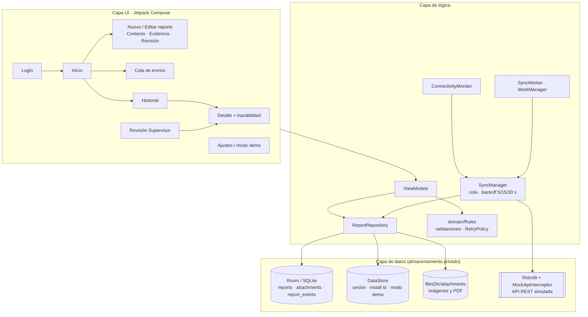
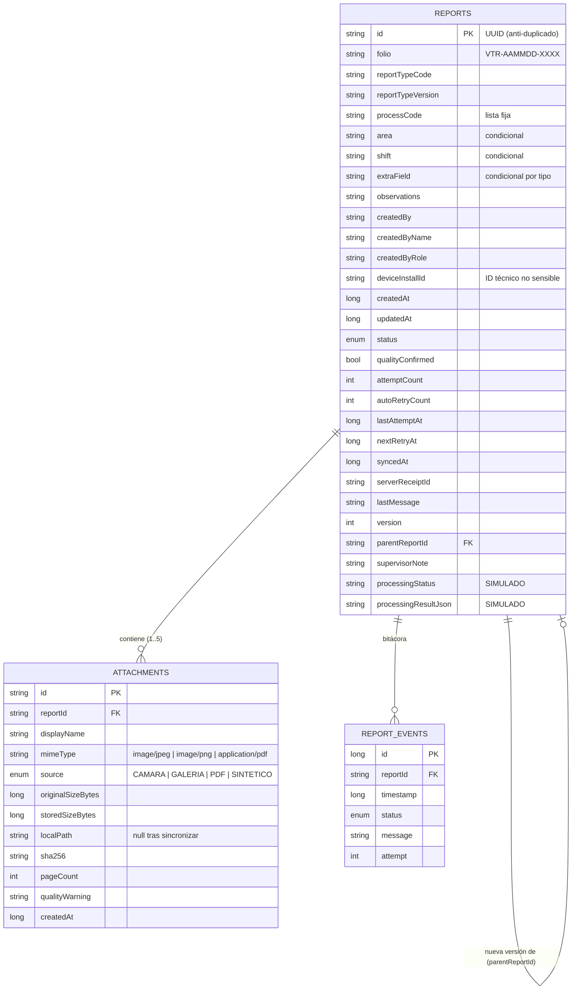
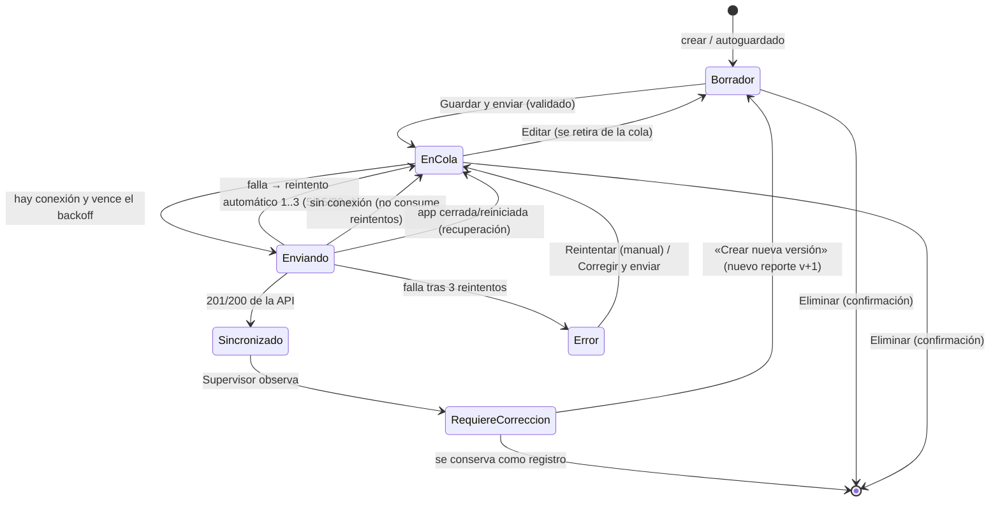
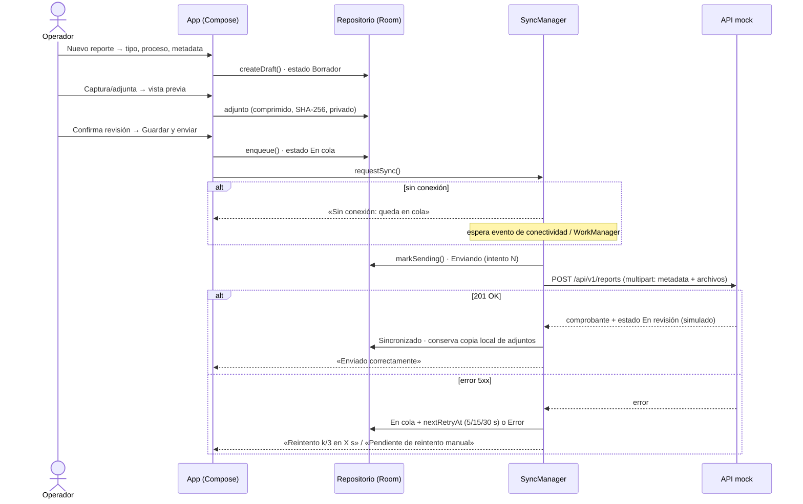

# Arquitectura — VITAIROS Captura (MVP DSY1105)

## 1. Diagrama de capas

## 2. Modelo de datos

## 3. Máquina de estados del reporte

## 4. Flujo principal (secuencia)

## 5. Decisiones y justificación

| Decisión | Motivo |
|---|---|
| Kotlin + Compose, arquitectura en capas sin framework DI | Recomendación de VITAIROS; contenedor manual (`AppContainer`) mantiene el MVP simple y explicable. |
| Room para reportes/adjuntos/eventos | Datos relacionales, consultas por estado, `UPDATE … WHERE status IN (…)` atómicos que evitan carreras entre edición y envío. |
| DataStore para preferencias | Sesión (solo ID), ID de instalación, modo demostración. |
| Bitácora `report_events` | Trazabilidad completa: creación, adjuntos, intentos, errores, sincronización, correcciones y versiones. |
| UUID + SHA-256 | El UUID es la referencia principal (API idempotente); el hash detecta el mismo archivo adjuntado dos veces. |
| Política de reintentos en `SyncManager` + `WorkManager` | El backoff 5/15/30 s es más corto que el mínimo de WorkManager (10 s exponencial); WorkManager actúa como respaldo con la app cerrada. |
| API mock vía interceptor OkHttp | Mismo código de red que con una API real; permite demostrar éxito, 500/503, sin conexión e idempotencia sin backend. |
| Copia local de adjuntos tras sincronizar | Ajuste solicitado: los archivos se conservan en el almacenamiento privado para consultarlos sin conexión. |
